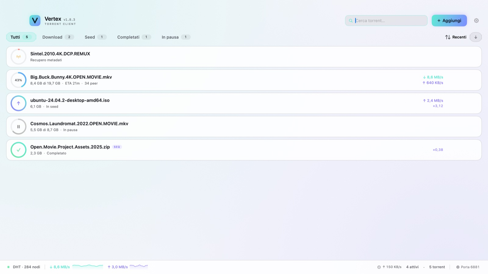

# Vertex

[English](README.md) · **Italiano**

**Client BitTorrent nativo per macOS**, scritto in SwiftUI e basato su libtorrent 2.1.
Niente Electron, niente pubblicità, nessuna telemetria. Open source con licenza MIT.

[](https://github.com/cicciocanestro/vertex/releases/latest)
[](LICENSE)
[](#requisiti)
[](https://github.com/cicciocanestro/vertex/actions/workflows/ci.yml)



## Download

[**Scarica l'ultima DMG**](https://github.com/cicciocanestro/vertex/releases/latest)

1. Apri la DMG.
2. Trascina **Vertex** nella cartella **Applicazioni**.
3. Al primo avvio macOS potrebbe chiedere una conferma (vedi sotto).

### Firma e notarizzazione

La release attuale è **firmata ad-hoc e non notarizzata**. Su un altro Mac Gatekeeper può
bloccare il primo avvio:

- fai clic destro su **Vertex** nel Finder e scegli **Apri**, oppure
- vai in **Impostazioni di Sistema → Privacy e Sicurezza** e scegli **Apri comunque**.

La firma Developer ID, l'hardened runtime e la notarizzazione Apple sono il prossimo passo
per la distribuzione; la build li supporta già: `VERTEX_SIGN_IDENTITY` seleziona l'identità
di firma (hardened runtime e timestamp al posto della firma ad-hoc) e `Scripts/notarize.sh`
invia la DMG a `notarytool` e applica il ticket. Senza certificato la release resta ad-hoc,
quindi aspettati questa conferma una tantum.

### Requisiti

- **macOS 15.0 (Sequoia)** o successivo.
- **Apple Silicon (arm64)**. La build attuale non è universale; Intel non è ancora
  supportato.

Verifica il download con il checksum pubblicato:

```bash
shasum -a 256 -c Vertex-*.dmg.sha256
```

## Caratteristiche

- Interfaccia nativa **SwiftUI** con tema chiaro, scuro e di sistema.
- Motore **libtorrent 2.1**: DHT, PEX, LSD, UPnP/NAT-PMP, tracker HTTP/UDP, magnet link,
  torrent v1 e v2.
- Aggiunta da magnet, file `.torrent`, trascinamento, appunti, Finder o browser.
- Ricerca, filtri, ordinamento e pannello dettagli con statistiche, file (priorità Skip/Normale/Alta) e tracker.
- Pausa/ripresa, download sequenziale, resume data ed errori visibili.
- Limiti globali di velocità, coda dei torrent attivi, porta, DHT, PEX, LSD e UPnP/NAT-PMP.
- **Interfaccia rinnovata**: sidebar delle impostazioni, inspector ridimensionabile, pill di
  stato per riga (inclusi stati in coda e completato), colonne estese sulle finestre larghe, toast con azione e navigazione da
  tastiera (`↑`/`↓`).
- **Associazione all'interfaccia**: il motore può essere vincolato a un solo indirizzo
  locale, così il traffico esce solo da lì. È la configurazione che rende utilizzabile il
  client dietro CGNAT insieme a un tunnel WireGuard e al port forwarding su un VPS.
- **Proxy SOCKS5 con protezione anti-leak (fail-closed)**: instrada tracker e peer attraverso
  un proxy anonimo (come Tor su `127.0.0.1:9050` o proxy VPN SOCKS5) con supporto opzionale
  all'autenticazione (password nel Portachiavi di macOS). Abilita automaticamente
  `anonymous_mode` rigoroso, disattiva UPnP/NAT-PMP
  per prevenire leak dell'IP locale del router e blocca il traffico se il proxy cade.
- **Diagnostica rete**: porta effettiva, IP locale, stato proxy, stato dei mapping e raggiungibilità TCP.
- Interfaccia in italiano o inglese in base alla lingua di sistema.
- **Nessuna telemetria**. Le uniche connessioni sono quelle BitTorrent e, solo quando avvii
  il test porta, api.ipify.org e check-host.net.
- Bundle autosufficiente: libtorrent e OpenSSL sono inclusi nell'app.

## Compilazione dai sorgenti

```bash
git clone https://github.com/cicciocanestro/vertex.git
cd vertex
./build.sh
open dist/Vertex.app
```

Per compilare servono Xcode Command Line Tools con Swift 6.0+ (testato con Swift 6.4) e
CMake 3.20+. La prima build compila le dipendenze fissate in `Scripts/deps.env`; le build
successive riusano `.build/vertex-deps`. Non serve alcuna libreria Homebrew a runtime.

```bash
./build.sh          # build release
./build.sh debug    # build debug
./build.sh test     # suite di test automatica
```

## Utilizzo

### Aggiungere un torrent

- **Aggiungi** nell'intestazione, oppure `⌘N` / `⌘O`.
- Incolla un magnet o scegli/trascina un file `.torrent`; il trascinamento funziona anche
  sulla finestra principale.
- I magnet aperti dal browser o dal Finder vengono gestiti da Vertex.
- La destinazione viene validata: un percorso file usa la cartella che lo contiene; una
  cartella non scrivibile produce un errore e il torrent non viene aggiunto.
- Le opzioni della finestra di aggiunta (cartella, avvio in pausa, sequenziale) valgono solo
  per quel torrent.

### Gestione dei torrent

- Pausa/ripresa, rimozione con o senza cancellazione dei file, **Mostra nel Finder**, **Sposta file…**
  su un'altra cartella o disco, copia del magnet e download sequenziale.
- Selezionando un torrent si apre il pannello dettagli con statistiche, priorità dei file e
  tracker.
- In caso di errore, il messaggio reale è visibile nella riga; messaggio e percorso sono
  nel pannello dettagli.

### Diagnostica rete

- Si apre dalla porta nella barra di stato, da **Impostazioni → Rete → Diagnostica rete**
  oppure con `⌘⇧D`.
- Mostra porta effettiva, IP locale, stato proxy SOCKS5, stato UPnP/NAT-PMP e nodi DHT. Gli errori di mapping
  sono separati per TCP e UDP, con il trasporto che li ha prodotti.
- Quando il proxy SOCKS5 è abilitato, un riquadro dedicato mostra host e porta del proxy,
  evidenziando chiaramente eventuali errori di mancata connessione.
- **Testa porta** verifica la raggiungibilità TCP tramite check-host.net; l'IP pubblico
  viene inviato solo quando avvii il test. Il traffico UDP/uTP non è verificato.
- Se la porta risulta chiusa, abilita UPnP/NAT-PMP o inoltra TCP/UDP verso l'IP locale;
  controlla anche di non essere dietro CGNAT.
- Con un'interfaccia associata il pannello mostra quell'indirizzo invece di quello della LAN
  e riporta il trasporto che ha fallito. Se l'indirizzo non è più disponibile lo dice
  esplicitamente: il motore non ripiega sull'interfaccia fisica.

### Impostazioni

- Cartella di download, limiti globali di velocità, porta di ascolto, DHT, PEX, LSD,
  UPnP/NAT-PMP.
- **Proxy SOCKS5**: attiva e configura un proxy anonimo (host, porta e credenziali opzionali
  RFC 1929). Le credenziali vengono inviate quando il campo **Utente** è compilato: in quel
  caso il bridge usa il tipo `socks5_pw` di libtorrent; senza utente il proxy resta `socks5`.
  Tutto il traffico verso tracker e peer passa dal proxy, mentre UPnP/NAT-PMP viene disattivato
  sul router locale. Un badge dedicato nella barra di stato (`SOCKS5`) ne monitora la raggiungibilità
  in tempo reale: verde menta quando è attivo, rosso corallo `[!]` quando il proxy non risponde.
- **Interfaccia di rete**: vincolando il client a un indirizzo IPv4 locale (per esempio
  quello di un tunnel WireGuard) il motore usa quell'indirizzo sia per il socket in ascolto
  (`listen_interfaces`) sia come sorgente delle connessioni in uscita
  (`outgoing_interfaces`), e libtorrent rifiuta il traffico che arriva sulle altre
  interfacce. Togliendo l'associazione torna il comportamento predefinito su tutte le
  interfacce. Sono accettati solo indirizzi IPv4 letterali; se l'indirizzo sparisce mentre il
  client è in esecuzione l'ascolto fallisce e la diagnostica spiega perché.
- Avvio in pausa e sequenziale predefiniti per i nuovi torrent; le scelte nella finestra di
  aggiunta restano valide solo per quel torrent.
- Tema scuro, chiaro o di sistema.
- DHT e LSD si applicano subito. Cambiare PEX ricrea la sessione libtorrent in background e
  ripristina i torrent attivi dal resume data. Porta e limiti vengono validati e i valori
  non validi vengono segnalati.
- Per un uso domestico normale lascia attivi DHT, PEX, LSD e UPnP. Disattiva DHT/PEX/LSD per
  ridurre la scoperta dei peer e UPnP su router non fidati. BitTorrent non è anonimo.

### Associazione all'interfaccia: comportamento alla disconnessione di WireGuard

**Requisiti:** macOS 15.0 (Sequoia) o successivo · Apple Silicon (`arm64`)

Quando selezioni un indirizzo in **Impostazioni → Rete → Interfaccia di rete** (es.
`10.8.0.2`), Vertex configura `libtorrent` con `listen_interfaces = "<ipv4_associato>:<porta>"`
e `outgoing_interfaces = "<ipv4_associato>"`:

- **Cambia interfaccia in automatico?** **No.** Se l'interfaccia del tunnel sparisce, Vertex
  non riporta `listen_interfaces` o `outgoing_interfaces` su `0.0.0.0` / `[::]` né
  sull'interfaccia fisica della LAN (`en0`).
- **Cosa succede ai trasferimenti attivi?** I trasferimenti **si fermano**. I socket
  associati all'indirizzo rimosso vengono invalidati da macOS, i nuovi tentativi in uscita
  falliscono il bind sull'IP sorgente assente e le connessioni in ingresso sulle altre
  interfacce locali vengono rifiutate da `libtorrent` (`invalid_local_interface`).
- **Diagnostica nella UI:** `listen_failed_alert` viene intercettato dall'engine,
  l'indicatore della porta nella barra di stato diventa rosso e **Diagnostica rete (`⌘⇧D`)**
  mostra *"Non in ascolto"* / *"Ascolto non disponibile"* con l'errore del socket finché
  l'indirizzo del tunnel non torna attivo o l'impostazione non viene cambiata manualmente.

> *Nota: quanto sopra descrive il comportamento di binding dei socket di Vertex
> (`listen_interfaces` / `outgoing_interfaces` in libtorrent 2.1.2) e come verificarlo; come
> previsto dalla licenza MIT, il software è fornito "così com'è" ("as is"), senza garanzie.*

#### Test di disconnessione riproducibile (manuale, con WireGuard)

1. Su **macOS 15.0+ (Apple Silicon `arm64`)**, attiva un tunnel WireGuard (es. `utun4` con
   IPv4 `10.8.0.2`).
2. In Vertex apri **Impostazioni (`⌘,`) → Rete → Interfaccia di rete** e seleziona
   `utun4 · 10.8.0.2`.
3. Avvia un trasferimento e verifica i socket IPv4 aperti:
   ```bash
   lsof -nP -c Vertex -i4
   ```
   Ogni socket TCP/UDP di `Vertex` risulta vincolato a `10.8.0.2`.
4. Disconnetti il tunnel WireGuard mentre il download è attivo.
5. **Risultato osservato:**
   - La velocità di trasferimento scende a `0 B/s` senza passare su `en0`;
   - `lsof -nP -c Vertex -i4` non mostra alcuna connessione peer stabilita sull'IP della LAN;
   - **Diagnostica rete (`⌘⇧D`)** segnala *"Ascolto non disponibile"*.

#### Test di disconnessione riproducibile (automatico, senza VPN)

`Tests/VertexTests/TorrentIntegrationTests.swift` (`networkSwitchDuringDownload`) avvia uno
swarm locale deterministico, sposta `bind_address` su un indirizzo RFC 5737 TEST-NET-3 non
assegnato (`203.0.113.9`) per simulare la caduta del tunnel, verifica `listening == false`,
`listenError != ""` e `downloaded == 0` byte, poi ripristina l'indirizzo valido e verifica
il completamento del download:

```bash
./build.sh test
```

### Scorciatoie

| Azione | Scorciatoia |
| --- | --- |
| Aggiungi file `.torrent` | `⌘O` |
| Aggiungi link magnet | `⌘N` |
| Incolla magnet dagli appunti | `⌘⇧V` |
| Cerca | `⌘F` |
| Pausa / riprendi | `⌘P` |
| Rimuovi torrent | `⌘⌫` |
| Mostra nel Finder | `⌘⇧R` |
| Copia link magnet | `⌘⇧C` |
| Mostra / nascondi dettagli | `⌘I` |
| Diagnostica rete | `⌘⇧D` |
| Filtri | `⌘1` … `⌘5` |
| Naviga la lista (con focus sulla lista) | `↑` / `↓` |
| Impostazioni | `⌘,` |

Pausa/Riprendi e Rimuovi agiscono sul torrent selezionato; senza selezione mostrano un
avviso.

### Dove salva i dati

- Download predefinito: `~/Downloads/Vertex`
- Stato e resume data: `~/Library/Application Support/Vertex/resume`
- Preferenze: `UserDefaults` (`app.vertex.torrent`)
- Password del proxy SOCKS5: Portachiavi di macOS (voce `app.vertex.torrent`), non in chiaro

Non è presente alcuna telemetria. L'app non è sandboxed e accede alle cartelle scelte e
alla cartella di download.

## Dettagli tecnici

### Riproducibilità e provenienza

- URL e SHA-256 di ogni dipendenza sono fissati in `Scripts/deps.env`.
- L'intera chiusura delle dipendenze viene copiata nell'app e verificata da
  `Scripts/verify-bundle.sh`.
- Il toolchain canonico è registrato in `Scripts/toolchain.env` e controllato dalla CI; i
  tag di release usano `Scripts/check-toolchain.sh --strict`.
- La DMG pubblicata è l'artefatto compilato e checksummato dalla CI. App e DMG locali non
  sono attese identiche bit-per-bit: Xcode/SDK, CMake, immagine del runner, percorso del
  checkout e timestamp HFS+/UDIF possono cambiare i byte.
- Usa il `.dmg.sha256` pubblicato per verificare l'artefatto canonico. Non confrontare
  l'hash di una DMG locale con l'asset CI.

### DMG e release

```bash
./Scripts/make-dmg.sh            # ricompila e crea la DMG
./Scripts/make-dmg.sh --no-build # usa dist/Vertex.app esistente
```

La DMG contiene l'app, il link ad **Applicazioni**, il file bilingue `Leggimi.txt` e
l'icona del volume. Produce:

- `Vertex-<versione>-macOS<minimo>-<architettura>.dmg`
- `Vertex-...dmg.sha256`

Lo script verifica firma, dipendenze, `minos` e architettura prima di creare la DMG e dopo
averla montata.

La pubblicazione è gestita dalla CI: i push su `main` producono un artefatto di build, solo
i tag `v*` creano una GitHub Release. Il tag deve corrispondere a `Info.plist`; gli asset
pubblicati non vengono sovrascritti. La DMG attuale è solo arm64; una release universale
richiede dipendenze per entrambe le architetture.

### Architettura

- `Sources/CTorrent` — bridge C++/C verso libtorrent: sessione, aggiunta torrent, snapshot
  JSON, dettagli file/tracker, resume data, priorità, validazione percorsi e comandi.
- `Sources/VertexKit` — libreria principale:
  - `Engine/Preferences.swift` — chiavi, default, validazione preferenze, configurazione sessione e migrazione della password proxy verso il Portachiavi;
  - `Engine/TorrentEngine.swift`, `TorrentEngine+Polling.swift`, `TorrentEngine+Actions.swift` — ciclo di vita della sessione, polling serializzato e azioni utente;
  - `Engine/PortReachabilityTester.swift` — test TCP esterno;
  - `Views/` — lista (pill di stato, colonne estese, navigazione da tastiera), inspector ridimensionabile, impostazioni a sidebar, sheet di aggiunta, diagnostica, status bar;
  - `Utilities/` — validazione input, drag&drop, localizzazione, rete, Portachiavi;
  - `Design/` — palette, componenti condivisi, chrome delle modali;
  - `Models/` — modelli snapshot, filtri, ordinamento, navigazione da tastiera, priorità file;
  - `DebugSupport.swift` — dati demo e cattura schermo, solo DEBUG.
- `Sources/Vertex` — entry point SwiftUI (`@main`, AppDelegate, gestione URL, finestra).
- `Tests/VertexTests` — suite automatica, inclusi test d'integrazione libtorrent su loopback.
- `Tests/Fixtures` — torrent deterministici v1/v2.
- `Scripts/` — build dipendenze fissate, verifica bundle, DMG, controllo localizzazioni,
  controllo toolchain e test runner.
- `Resources/` — `Info.plist`, localizzazioni e licenze di terze parti.
- `.github/workflows/ci.yml` — build/test su push e PR; release sui tag.

### Sviluppo e test

```bash
./Scripts/check-toolchain.sh --warn  # toolchain locale non canonico ammesso
./build.sh debug
./build.sh test
./Scripts/build-deps.sh --force      # ricompila le dipendenze fissate
```

`./build.sh test` produce `dist/test-results.xml` (JUnit) e `dist/coverage/` (testo e
LCOV). La CI carica entrambi. La suite copre formattatori, decodifica snapshot JSON,
modelli, preferenze, ciclo vitale del bridge C++, engine (aggiunta, dettaglio, priorità,
pausa/ripresa, riavvio PEX, shutdown), navigazione da tastiera, raggiungibilità rete con
loader HTTP finto e routing dei comandi. I test d'integrazione su loopback coprono
trasferimenti v1/v2, ricaricamento del resume, priorità file, rimozione e failure path
senza tracker esterni. Le viste SwiftUI
e le varianti modali vengono renderizzate off-screen con `ImageRenderer`; lo smoke test
UPnP/NAT-PMP gira solo con `VERTEX_TEST_UPNP=1` in CI.

Le build DEBUG offrono dati demo, cattura finestra e un toast di prova
(`VERTEX_DEMO=1`, `VERTEX_SNAPSHOT=/percorso/immagine.png`, `VERTEX_DEMO_TOAST=1`).

## Limitazioni

- macOS 15.0+ su Apple Silicon (arm64); per Intel serve una build universale con dipendenze
  per entrambe le architetture.
- Firma ad-hoc, non notarizzata: su un altro Mac aspettati la conferma di Gatekeeper. Il
  supporto per la firma Developer ID e la notarizzazione è già presente (vedi sopra).
- Interfaccia in italiano o inglese in base alla lingua di sistema; nessuna altra lingua.
- Client volutamente minimale: niente RSS, ricerca torrent integrata o scheduler.
- La DMG è specifica per l'architettura del Mac di build (arm64 su Apple Silicon).

## Contribuire

Issue e pull request sono benvenute. Prima di aprire una PR esegui `./build.sh test` e
mantieni allineati README e tabelle di localizzazione italiano/inglese.

## Changelog

Le modifiche tra le versioni sono documentate in [`CHANGELOG.md`](CHANGELOG.md).

## Licenza

Vertex è distribuito con **licenza MIT**: vedi [`LICENSE`](LICENSE).

Le librerie incluse mantengono le proprie licenze:

- **libtorrent-rasterbar** — BSD 3-Clause
- **OpenSSL** — Apache License 2.0
- **Boost** (solo header in fase di compilazione) — Boost Software License 1.0

I testi completi sono in [`Resources/Licenses/`](Resources/Licenses) e
[`THIRD_PARTY_NOTICES.md`](THIRD_PARTY_NOTICES.md). Sono inclusi anche nel bundle e
raggiungibili da **Vertex → Licenze open source**.
