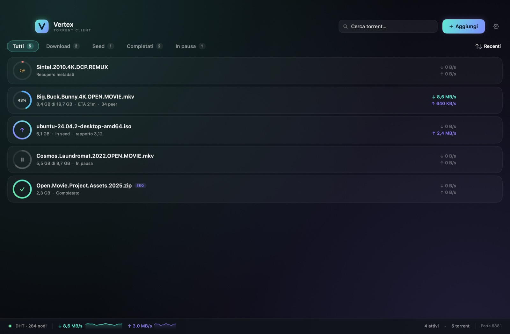

# Vertex

**Client BitTorrent nativo per macOS**, scritto in SwiftUI e basato su libtorrent.
Interfaccia minimale con tema chiaro/scuro/sistema, pannello dettagli, ricerca, filtri
e gestione completa di magnet link e file `.torrent`.



## Caratteristiche

- Motore **libtorrent 2.1**: DHT, PEX, LSD, UPnP/NAT-PMP, tracker HTTP/UDP, magnet link,
  torrent v1 e v2.
- Aggiunta da link magnet, file `.torrent`, trascinamento, appunti, doppio clic nel Finder
  o link magnet aperti dal browser (schema `magnet` registrato).
- Download, seed, pausa/ripresa, verifica dei file e recupero dei metadati.
- Ricerca istantanea, filtri (tutti, download, seed, completati, in pausa) e ordinamento.
- Pannello dettagli con statistiche, file con priorità e stato dei tracker.
- Limiti globali di velocità, porta di ascolto, DHT, UPnP/NAT-PMP.
- Pannello **Diagnostica rete**: porta effettiva, IP locale, stato UPnP/NAT-PMP e test TCP di
  raggiungibilità esterna.
- Tema scuro, chiaro o di sistema, applicato immediatamente.
- Ripresa automatica della sessione tramite resume data, con validazione dei percorsi.
- Errori visibili con messaggio e percorso nel pannello dettagli.
- Bundle autosufficiente: libtorrent e OpenSSL sono inclusi nell'app.

## Requisiti

- **macOS 27.0** — le librerie Homebrew attualmente utilizzate sono compilate con SDK 27.
  Per supportare versioni precedenti di macOS è necessario ricompilare libtorrent con un
  deployment target più basso.
- **Xcode Command Line Tools** con Swift 6.x (testato con Swift 6.4). Non serve Xcode completo.
- **Homebrew** e le dipendenze del motore:

```bash
brew install libtorrent-rasterbar boost openssl@4
```

Testato su Apple Silicon. Su Intel lo script rileva il prefisso Homebrew con
`brew --prefix`; l'app non è stata testata su Intel.

## Installazione

Se è disponibile una release, scarica la DMG dalla sezione
[**Releases**](https://github.com/cicciocanestro/vertex/releases), aprila e trascina
**Vertex** nella cartella Applicazioni.

In alternativa, compila dai sorgenti:

```bash
git clone https://github.com/cicciocanestro/vertex.git
cd vertex
brew install libtorrent-rasterbar boost openssl@4
./build.sh
open dist/Vertex.app
```

`build.sh` genera anche l'icona se manca, copia le licenze nel bundle e verifica che
l'app non dipenda più da Homebrew.

## Compilazione

```bash
./build.sh          # build release
./build.sh debug    # build debug
open dist/Vertex.app
```

Lo script:

1. compila il pacchetto Swift;
2. crea `dist/Vertex.app`;
3. genera l'icona se manca;
4. copia `libtorrent`, OpenSSL e le licenze dentro il bundle;
5. riscrive i percorsi delle dylib e applica una firma ad-hoc;
6. verifica che il bundle non dipenda più da Homebrew.

Se esegui `swift build` senza `build.sh` e Homebrew non è in `/opt/homebrew`, esporta
prima `HOMEBREW_PREFIX`:

```bash
export HOMEBREW_PREFIX="$(brew --prefix)"
swift build -c release
```

## Release DMG

```bash
./Scripts/make-dmg.sh            # ricompila e crea la DMG
./Scripts/make-dmg.sh --no-build # usa dist/Vertex.app esistente
```

Produce in `dist/`:

- `Vertex-<versione>-macOS<versione minima>-<architettura>.dmg`
- `Vertex-...dmg.sha256`

La DMG contiene `Vertex.app`, un collegamento ad **Applicazioni**, il file `Leggimi.txt`
e l'icona del volume. Le licenze sono incluse nell'app e raggiungibili dal menu
**Vertex → Licenze open source**. Lo script verifica la firma dell'app montata e genera
il checksum SHA-256.

L'architettura della DMG dipende dal Mac su cui viene creata: su Apple Silicon è
`arm64`, su Intel è `x86_64`. Per una release universale servono librerie universali.

La firma dell'app è **ad-hoc** perché l'ambiente di build non dispone di un certificato
Developer ID. La DMG è quindi distribuibile, ma su un altro Mac potrebbero comparire gli
avvisi Gatekeeper descritti nelle note. Per una distribuzione pubblica senza avvisi serve
firmare con Developer ID, abilitare l'hardened runtime e notarizzare l'app con
`notarytool` e `stapler` prima di creare la DMG.

## Utilizzo

### Aggiungere un torrent

- Pulsante **Aggiungi** nell'intestazione, oppure `⌘N` / `⌘O`.
- Nella finestra di aggiunta puoi incollare un link magnet o scegliere/trascinare un
  file `.torrent`; il trascinamento funziona anche sul resto della finestra.
- I link magnet aperti dal browser o dal Finder vengono gestiti dall'app come client
  BitTorrent.
- La cartella di destinazione viene validata: se viene indicato un file, viene usata la
  cartella che lo contiene; se non è scrivibile, l'app torna alla destinazione predefinita.
- Le opzioni della finestra di aggiunta (cartella, avvio in pausa, download sequenziale)
  valgono **solo per quel torrent**. I valori predefiniti si configurano nelle Impostazioni.

### Gestione dei torrent

- Pausa/ripresa, rimozione con o senza cancellazione dei file, “Mostra nel Finder”,
  copia del link magnet e download sequenziale.
- Selezionando un torrent si apre il pannello dettagli con statistiche, file (con priorità)
  e tracker.
- In caso di errore, il messaggio reale e il percorso coinvolto sono visibili nella riga
  e nel pannello dettagli.

### Diagnostica rete

- Si apre dal numero di porta nella barra di stato, da **Impostazioni → Rete → Diagnostica
  rete**, oppure con `⌘⇧D`.
- Mostra porta effettiva, IP locale, stato delle mappature UPnP/NAT-PMP e nodi DHT.
- **Testa porta** verifica la raggiungibilità TCP tramite check-host.net: l’IP pubblico
  viene inviato al servizio solo quando avvii il test. Il traffico UDP/uTP non è verificato.
- Se la porta risulta chiusa, abilita UPnP/NAT-PMP sul router o inoltra TCP e UDP verso
  l’IP locale; verifica anche di non essere dietro CGNAT.

### Impostazioni

- Cartella di download, limiti globali di download/upload, porta di ascolto,
  DHT, UPnP/NAT-PMP.
- Avvio in pausa e download sequenziale predefiniti per i nuovi torrent; le scelte fatte
  nella finestra di aggiunta valgono solo per il singolo torrent.
- Tema scuro, chiaro o di sistema.
- La cartella di download vale per i nuovi torrent; i torrent già aggiunti mantengono
  il proprio percorso.

## Scorciatoie

| Azione | Scorciatoia |
| --- | --- |
| Aggiungi file `.torrent` | `⌘O` |
| Aggiungi link magnet | `⌘N` |
| Incolla magnet dagli appunti | `⌘⇧V` |
| Cerca | `⌘F` |
| Pausa / riprendi | `⌘P` |
| Rimuovi torrent | `⌘⌫` |
| Mostra nel Finder | `⌘⇧R` |
| Copia link magnet | `⌘⇧C` |
| Mostra / nascondi dettagli | `⌘I` |
| Diagnostica rete | `⌘⇧D` |
| Filtri | `⌘1` … `⌘5` |
| Impostazioni | `⌘,` |

Pausa/Riprendi e Rimuovi agiscono sul torrent selezionato; senza selezione mostrano un avviso.

## Dove salva i dati

- Download predefinito: `~/Downloads/Vertex`
- Stato e resume data: `~/Library/Application Support/Vertex/resume`
- Preferenze: `UserDefaults` (`app.vertex.torrent`)

Non è presente alcuna telemetria. Le uniche connessioni di rete sono quelle del motore
BitTorrent e, solo quando avvii il test porta, quelle verso api.ipify.org e check-host.net.
L'app non è sandboxed e accede alle cartelle scelte e alla cartella di download.

## Architettura

- `Sources/CTorrent` — bridge C++/C verso libtorrent: sessione, aggiunta torrent,
  snapshot JSON, dettagli file/tracker, resume data, priorità, validazione dei percorsi
  e comandi.
- `Sources/Vertex` — app SwiftUI:
  - `Engine/TorrentEngine.swift` — polling del motore e stato pubblicato;
  - `Engine/PortReachabilityTester.swift` — test TCP esterno tramite check-host.net;
  - `Views/` — lista, righe, pannello dettagli, finestra di aggiunta, impostazioni,
    diagnostica rete, barra di stato;
  - `Utilities/NetworkInfo.swift` — rilevamento dell’IP locale;
  - `Design/` — palette adattiva, componenti, animazioni;
  - `Models/` e `Utilities/` — modelli e formattazione italiana.
- `Sources/Vertex/DebugSupport.swift` — dati demo e cattura schermo, solo build DEBUG.
- `Scripts/make-icon.swift` — genera l'icona `.icns` con CoreGraphics.
- `Scripts/make-dmg.sh` — crea la DMG distribuibile con checksum SHA-256.
- `Resources/Info.plist` — bundle, associazione `.torrent`, versione minima.
- `Resources/Licenses/` — testi delle licenze incluse nel bundle.

## Sviluppo

```bash
./build.sh debug
```

Nelle build DEBUG sono disponibili dati demo e la cattura automatica della finestra
(`VERTEX_DEMO=1`, `VERTEX_SNAPSHOT=/percorso/immagine.png`). Non è inclusa una suite di
test automatica: il bridge C++ è stato verificato con un harness dedicato per aggiunta,
pausa, resume, priorità dei file e rimozione.

## Limitazioni

- macOS 27.0 con le librerie Homebrew attuali; per versioni precedenti va ricompilato
  libtorrent con un deployment target inferiore.
- Firma ad-hoc, non notarizzata: su un altro Mac potrebbe essere necessario scegliere
  “Apri comunque” dal menu contestuale del Finder. Per la distribuzione conviene firmare
  con Developer ID e notarizzare.
- Interfaccia solo in italiano.
- Client volutamente minimale: nessun RSS, ricerca torrent integrata, scheduler o limite
  automatico di rapporto.
- Il seed continua finché il torrent non viene messo in pausa.
- Non è presente lo spostamento dei dati di un torrent già aggiunto.
- La DMG generata è specifica per l'architettura del Mac di build (arm64 su Apple Silicon).

## Changelog

Le modifiche tra le versioni sono documentate in [`CHANGELOG.md`](CHANGELOG.md).

## Licenza

Vertex è distribuito con **licenza MIT**: vedi [`LICENSE`](LICENSE).

Le librerie incluse mantengono le proprie licenze:

- **libtorrent-rasterbar** — BSD 3-Clause
- **OpenSSL** — Apache License 2.0
- **Boost** (solo header in fase di compilazione) — Boost Software License 1.0

I testi completi sono in [`Resources/Licenses/`](Resources/Licenses) e in
[`THIRD_PARTY_NOTICES.md`](THIRD_PARTY_NOTICES.md). Sono inclusi anche nel bundle e
raggiungibili da **Vertex → Licenze open source**.
